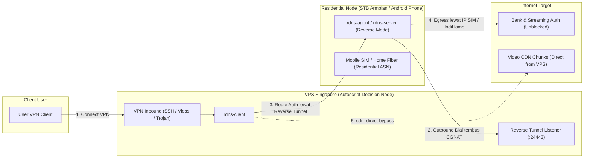

# RDNS Roadmap: Residential & Mobile SIM Egress Architecture

Dokumen ini mendokumentasikan visi pengembangan dan roadmap teknis arsitektur **RDNS (Residential & Mobile SIM SmartDNS)** untuk perangkat lokal seperti **STB Armbian** dan **Smartphone Android (ARMv7a / ARM64)**.

---

## 1. Latar Belakang & Urgensi Masalah

Saat ini, sebagian besar exit node SmartDNS di-deploy pada VPS cloud (seperti DigitalOcean, Linode, AWS, Hetzner, dsb.). Meskipun teknologi mTLS Yamux tunnel berhasil memindahkan lokasi routing, penyedia layanan streaming (Netflix, Disney+ Hotstar) dan perbankan modern semakin agresif dalam memblokir ASN Datacenter/Hosting.

**Solusi:** Memanfaatkan koneksi internet rumahan (*Residential ISP* seperti IndiHome, Biznet, TIME, Unifi) atau koneksi seluler (*Mobile SIM 4G/5G* seperti Telkomsel, Indosat, XL, Digi Malaysia, Maxis) sebagai **Residential SmartDNS Exit Node**.

---

## 2. Tantangan Teknis: CGNAT & Inverted Architecture

### Masalah CGNAT (Carrier-Grade NAT)
Kartu SIM seluler dan koneksi fiber rumahan berada di balik CGNAT:
- Perangkat tidak memiliki IP publik statis (mendapatkan IP private seperti `100.64.x.x` atau `10.x.x.x`).
- Seluruh port inbound (80, 443, 53) diblokir oleh operator / firewall ISP.
- VPS cloud tidak dapat melakukan inisiasi koneksi langsung (*inbound dial*) ke STB atau HP.

### Solusi Arsitektur: Inverted / Reverse Tunneling



---

## 3. Fitur Utama & Prinsip Desain

### A. Proteksi Kuota Kartu SIM (`cdn_direct: true`)
Kelemahan terbesar jika menggunakan proxy/VPN biasa di kartu SIM adalah kuota data cepat habis tersedot video streaming 4K.
- Pada arsitektur RDNS, fitur `cdn_direct: true` memastikan bahwa:
  1. **Hanya DNS query dan token autentikasi/metadata** (beberapa KB/MB) yang dialirkan lewat kartu SIM HP/STB.
  2. **Seluruh chunk video CDN resolusi tinggi** (`nflxvideo.net`, `googlevideo.com`, `aiv-cdn.net`, dsb.) langsung terhubung secara **direct** dari VPS Singapore ke CDN edge lokal terdekat.
  3. Kuota kartu SIM Anda sangat hemat (awet berbulan-bulan), namun status verifikasi lokasi tetap 100% terdeteksi sebagai Residential SIM.

### B. Dukungan Multi-Arsitektur Hardware
1. **STB Armbian (Amlogic S905X / S905W / Allwinner / Rockchip):**
   - Arsitektur: `linux/arm64`.
   - OS: Armbian Ubuntu / Debian.
   - Konektivitas: Modem USB 4G LTE atau LAN IndiHome/Biznet.
   - Daemon berjalan via systemd atau OpenRC dengan auto-restart.
2. **Handphone Android (ARMv7a & ARM64):**
   - Arsitektur: `arm64-v8a` (HP 64-bit modern) dan `armeabi-v7a` (HP 32-bit legacy).
   - Runtime: Termux (Non-root userland) atau Rooted Android via Magisk.
   - Langsung memanfaatkan slot SIM fisik / eSIM di dalam HP.

---

## 4. Tahapan Implementasi (Roadmap Phases)

### Phase 1: Overlay P2P Tunneling (Tersedia Saat Ini)
- **Metode:** Menggunakan WireGuard atau Rathole point-to-point bridge.
- **Mekanisme:**
  1. VPS Singapore bertindak sebagai WireGuard Server (`10.99.0.1`).
  2. STB Armbian / HP Termux dial outbound sebagai WireGuard Client (`10.99.0.2`).
  3. `rdns-server` berjalan di STB/HP mendengarkan di IP `10.99.0.2:443` dan `10.99.0.2:53`.
  4. `rdns-client` di Singapore mengarahkan token pairing ke `10.99.0.2`.
  5. STB/HP mengaktifkan IP Masquerade ke kartu SIM (`iptables -t nat -A POSTROUTING -o rmnet+ -j MASQUERADE`).

### Phase 2: Native Inverted mTLS Mode di Core Engine Go
- **Target:** v0.3.0
- **Mekanisme:**
  - Ditambahkan mode flag `-reverse` pada `rdns-server`:
    ```bash
    rdns-server -reverse -connect vps-sg.example.com:24443 -token rdns://...
    ```
  - `rdns-client` membuka reverse listener Yamux.
  - Begitu STB/HP terhubung keluar, session Yamux dibalik arah sehingga VPS Singapore dapat membuka virtual stream ke arah STB/HP untuk relay DNS dan SNI.
  - Tidak memerlukan instalasi WireGuard atau software tambahan lain (single static binary).

### Phase 3: Android Native Background App / Service
- **Target:** v0.4.0
- **Mekanisme:**
  - Aplikasi Android APK ringan (Golang Gomobile / Flutter) untuk HP Android.
  - One-tap start/stop service dengan wakelock agar tidak dimatikan oleh sistem manajemen baterai Android.
  - Menampilkan status kuota, latency, dan IP publik kartu SIM secara real-time.

---

## 5. Ringkasan Nilai Bisnis
- **Zero Datacenter Flag:** Bypass 100% proteksi anti-VPN pada platform streaming internasional dan perbankan lokal.
- **Hemat Biaya:** Biaya langganan kartu SIM jauh lebih terjangkau dibandingkan sewa server IP Residential komersial.
- **Fleksibel:** Pengguna dapat menaruh STB di Malaysia (Unifi/Digi), Indonesia (IndiHome/Telkomsel), atau negara lain, lalu menghubungkannya ke VPS Singapore yang sama.
